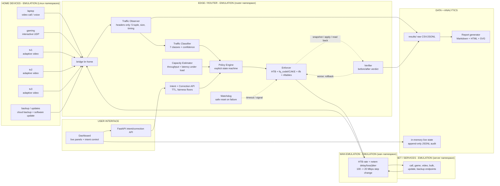

# Phase 0 Plan - Adaptive QoS Engine for Mixed Home Broadband Traffic

Status: **PHASE 0 ONLY - AWAITING APPROVAL**
Date: 2026-10-23
Source brief: `Case Study PS/Case Study 3_MCV_Adaptive QoS Engine for Mixed Home Broadband Traffic.pdf`
Project: TELIPORT Season 4 - Tata Elxsi, Case Study 3

This document is the Phase 0 deliverable. It contains:

- an honest audit of what already exists in this repository;
- the target architecture and repository structure;
- technology choices with reasons;
- the phased build plan and gates;
- risks and decisions that need approval.

The requirement-by-requirement matrix is in
[`docs/TRACEABILITY.md`](TRACEABILITY.md). Plain-language explanations are in
[`docs/CONCEPTS.md`](CONCEPTS.md).

No application code was changed in Phase 0.

---

## 1. The existing repository is a strong prototype, not a compliant final answer

This repository already contains a prior prototype called **ACIQ**. It is not a
blank directory. It has real modules, tests, testbed scripts, and prior evidence.
The correct engineering decision is to **extend and revalidate it**, not to throw
it away. The audit below is deliberately specific about where it falls short of
the current brief.

### 1.1 What is already useful

| Area | Existing artifact | Assessment |
|---|---|---|
| Flow observation | `aciq/flowtrack.py`, `aciq/metrics.py` | Conntrack-based metadata; IPv4/IPv6 proven in prior gate evidence |
| Classification | `aciq/classify.py`, `aciq/corrections.py` | Rule-based, confidence, abstention, user correction |
| Capacity estimation | `aciq/capacity.py` | Passive counter/goodput estimation, step-change tests |
| Policy | `aciq/policy.py` | Floors, ceilings, rate invariants, lease influence |
| Enforcement | `aciq/tc.py`, `qdisc.py`, `bridge.py`, `marks.py`, `txn.py` | HTB, fq_codel/CAKE, filters, read-back, rollback |
| Verification | `aciq/measure.py`, `metrics.py`, `closedloop.py` | Latency/jitter/loss arithmetic, enforcement loop |
| Intent | `aciq/intent.py`, `api.py` | Time-boxed lease, TTL, API, auth/rate-limit hardening |
| Dashboard | `aciq/dashboard.py` | Six required panels, inline SVG, read-only rendering |
| Experiments | `aciq/experiment.py`, `harness.py`, `report.py`, `run_experiments.py` | Baseline/optimized runs, report generation |
| Testbed | `testbed/setup.sh`, `cleanup.sh`, `gate.sh`, `workloads/` | Namespaces, veth, HTB, netem, dual-stack evidence |
| Evidence | `data/`, `artifacts/`, `docs/evidence/` | Prior measured runs, revision-stamped |

**Real Phase 0 test result (run in this environment):**

```text
python3 -m unittest discover -s tests -q
Ran 1223 tests in 54.173s
OK (skipped=10)
```

The raw log is saved at
[`docs/evidence/phase0/unittest-20261023.log`](evidence/phase0/unittest-20261023.log).
This is an unprivileged test run. It does not prove the live network behavior;
live tests are separately gated and need root.

### 1.2 Where the current repository does not meet this brief

These are gaps, not cosmetic differences. Each will be closed or explicitly
documented in the phases listed in the traceability matrix.

| Gap | Current state | Required state | Phase |
|---|---|---|---|
| Traffic classes | `realtime_interactive`, `adaptive_video`, `bulk_transfer`, plus `leased_flow` | At least `video_call/voice`, `interactive_gaming`, `adaptive_video_streaming`, `bulk_download`, `software_update`, `cloud_backup`, `unknown` | 2 |
| Packet-level metadata | Conntrack bytes/packets; no inter-arrival series or packet-size samples | 5-tuple, direction, packet sizes, inter-arrival, bytes/s, duration, protocol, IPv4/IPv6 | 2 |
| Policy state machine | Shield modes `MONITOR`, `FAULT_PENDING`, `SAFE_HELD`; no required FSM | Explicit `INIT`, `NORMAL`, `CONGESTED`, `INTENT_ACTIVE`, `RECALIBRATING`, `SAFE_MODE`, `ROLLING_BACK` | 4 |
| Capacity inputs | Passive counters/goodput only; latency deliberately excluded | Passive throughput **plus latency-under-load** signals | 3 |
| Intent | Device/flow lease; no class target | Class/device/flow intent, TTL, max duration, minimum-share fairness | 5 |
| Testbed clients | One `client` namespace | Laptop, gaming, three TVs, backup/updates client; separate server namespace | 1 |
| Scenarios | S1-S3 plus an internal `s4_capacity_recovery` | Required S1-S3, required S4 intent, required S5 failure injection; rename old S4 | 7 |
| Repetitions | 6-7 seeds in prior evidence | At least 10 seeds, logged, mean and confidence interval | 7 |
| Calibration | Confusion matrix, P/R/F1, high-confidence errors | Plus calibration (Brier/ECE/reliability) | 2 |
| API default | stdlib `http.server` (documented deviation) | FastAPI primary adapter, stdlib fallback, pinned versions | 5 |
| Dashboard control | Read-only six panels | Panels plus state/policy/intent/confidence and a simple intent control | 6 |
| Ingress shaping | Egress shaping; ifb path not a required deliverable in prior code | ifb ingress shaping for download direction | 4 |
| Safe reset / Makefile | No Makefile, no `make safe-reset` | `make demo`, `make safe-reset`, `make test`, `make lint`, `make secret-scan` | 1, 8 |
| Secret scan | `.gitignore` and `.env.example` exist; no scan step | Automated secret scan and test | 8 |
| Required docs | Lowercase `docs/setup.md`, `docs/licenses.md`, `docs/limitations.md` | Canonical `docs/SETUP.md` (to be written), `docs/THIRD_PARTY_LICENSES.md` (to be written), `docs/LIMITATIONS.md` (to be written), plus `CONCEPTS.md`, `MODULES.md` | 8 |
| Architecture image | ASCII diagram in `docs/architecture.md` | Mermaid source plus exported image | 8 |
| Results directory | `data/` and `artifacts/` | `results/` with raw CSV/JSON and generated report | 7 |
| Host execution | Prior live evidence exists; this sandbox has no `tc`/`ip` and no passwordless sudo | Reproducible commands + captured evidence on the host | 1 |
| WAN recovery | Internal `s4_capacity_recovery` | Keep as S2b regression, not as the required S4 | 7 |

The prior documentation contains measured claims. They are treated as **prior
evidence**, not as Phase 0 results. Phase 1 will re-run the gate and the baseline
on the current revision. No number will be carried into a final report without a
fresh raw artifact or an explicit "prior evidence" label.

---

## 2. Environment detected in Phase 0

These are commands that were actually run. Raw output is saved under
`docs/evidence/phase0/`:
[`environment-20261023.log`](evidence/phase0/environment-20261023.log) and
[`unittest-20261023.log`](evidence/phase0/unittest-20261023.log).

### 2.1 This agent runs inside a Flatpak VS Code sandbox

| Check | Result |
|---|---|
| Working directory | `/home/mekarz/Desktop/Full-projects/TATA-ELXSI` |
| User | `uid=1000(mekarz)`, no effective capabilities |
| `ip`, `tc`, `nft`, `iperf3`, `ping`, `sudo` inside sandbox | **not available** |
| Host access | `flatpak-spawn --host` works |
| Host user | `uid=1000(mekarz)`, groups include `sudo`; `sudo -n true` says **a password is required** |

**Consequence:** the agent cannot run root-only live `tc`/namespace experiments
unattended. Phase 1 commands that need root must be run by the user, or the user
must configure passwordless sudo for the specific testbed commands. The agent
will provide exact commands and will not invent live results. Unprivileged unit
tests, linting, report generation, and static analysis can run here.

### 2.2 Host toolchain (detected via `flatpak-spawn --host`)

| Component | Detected value |
|---|---|
| OS | Pop!_OS 24.04 (Ubuntu 24.04 base) |
| Kernel | `7.1.5-76070105-generic` |
| `ip` / `tc` (iproute2) | `6.1.0`, libbpf 1.3.0 |
| `nft` | nftables v1.0.9 (Old Doc Yak #3) |
| `iperf3` | iperf 3.16 (cJSON 1.7.15) |
| `conntrack` | conntrack v1.4.8 |
| `ethtool` | 6.7 |
| Host Python | 3.12.3; `python3.12` 3.12.15 |
| Sandbox Python | 3.13.15 |
| Mermaid CLI (`mmdc`) | not installed |
| Graphviz (`dot`) | not installed |
| Node / npm / npx | 24.21.0 / 11.19.0 / present |
| Secret scanners (`gitleaks`, `trufflehog`, `git-secrets`, `detect-secrets`) | not installed |
| Passwordless sudo | **no** |

Python 3.11+ is satisfied. No version is guessed: dependency versions added in
later phases will be recorded from `pip freeze` and `command -V` at that time.

### 2.3 Test and evidence status

- 1223 unprivileged tests pass; 10 skipped. This is a real run on the sandbox
  Python 3.13.15.
- The skipped tests are the live/root-dependent tests. They are not evidence of
  live behavior.
- The prior live evidence in `data/host_gate_*` and `docs/evidence/` is kept, but
  Phase 1 must revalidate it on the current revision and current brief.

---

## 3. Design principles

1. **Metadata only.** Classify from packet headers and flow statistics. Never
   read, store, decrypt or inspect application payloads. No SNI, no DNS payload,
   no HTTP parsing, no TLS decryption.
2. **One controller, one writer.** Only the enforcer writes `tc` and nftables.
   The dashboard and classifier can never write policy.
3. **Observe, decide, enforce, verify, roll back.** Every automated change has a
   measurable before/after verdict and a saved snapshot.
4. **Bounded and reversible.** Rate changes are limited per step, have min/max
   bounds, obey cooldown, and are reversible to a known safe state.
5. **No starvation.** Every class has a guaranteed minimum share. An intent can
   boost a target but cannot delete another class's floor.
6. **Evidence or it did not happen.** Every number comes from a script run with
   raw data saved under `results/` or a labelled prior-evidence directory.
7. **Emulation is labelled.** The home, WAN, and devices are Linux namespaces,
   not hardware. Reports must say **EMULATION** and explain the model.
8. **Reproducible by a stranger.** Versions, seeds, impairment settings, scripts,
   commands and expected verification steps are committed.

---

## 4. Target architecture

The diagram source will be committed as
`docs/diagrams/architecture.mmd` (to be written) and exported to
`docs/diagrams/architecture.svg` (or `.png`; the image does not exist yet) in Phase 8. The export command and
tool version will be recorded. The current `docs/architecture.md` will be
updated to the final diagram and contracts.



### 4.1 Components and responsibilities

| Layer | Component | Responsibility |
|---|---|---|
| Device | Home namespaces | Generate known, labelled workloads |
| Edge | Observer | Per-flow header metadata only |
| Edge | Classifier | Class + confidence, correction override |
| Edge | Capacity estimator | WAN capacity + confidence + step detection |
| Edge | Policy engine | Explicit FSM, per-class rates/ceilings/floors |
| Edge | Enforcer | Sole kernel writer: HTB, leaf qdisc, ifb, nft marks |
| Edge | Verifier | Before/after metrics and improved/not/worse verdict |
| Edge | Watchdog | Crash/signal/timeout -> known safe state |
| Network | WAN emulation | Rate, delay, loss, jitter, dynamic step change |
| Server | Service emulation | Sinks/sources for all seven classes |
| Data | Evidence store | Raw CSV/JSONL, summary JSON, manifests |
| Analytics | Report generator | Tables, graphs, CIs, verdicts |
| UI | API + dashboard | Intent/correction control and read-only live view |

### 4.2 Closed loop (the core of Case Study 3)

```text
observe -> classify -> estimate capacity -> decide policy
   -> enforce atomically -> verify before/after -> rollback if worse
   -> update state -> repeat
```

Every step has a timestamp, a reason and a structured log record. The policy
state machine records transitions, not just final values.

---

## 5. Target repository structure

`K` = keep, `E` = extend/refactor, `N` = new. Existing evidence directories are
kept; they are not deleted by this plan.

```text
TATA-ELXSI/
├── Makefile                          N  demo, safe-reset, test, lint, secret-scan, testbed
├── README.md                         E  honest status, quick start, evidence links
├── requirements.txt                  N  pinned runtime/test dependencies (recorded from install)
├── pyproject.toml                    E  lint/type/test configuration
├── .env.example                      E  fictitious values only; no real secrets
├── .gitignore                        E  exclude secrets, include selected raw evidence
├── LICENSE                           K  MIT
├── docs/
│   ├── CONCEPTS.md                   N  plain-language concepts (English; Thanglish in chat)
│   ├── MODULES.md                    N  9 modules x inputs/outputs/states/failure/success
│   ├── SETUP.md                      N  (to be written) exact versions, commands, root requirements
│   ├── THIRD_PARTY_LICENSES.md       N  (to be written) license inventory and GPL/AGPL flags
│   ├── LIMITATIONS.md                N  (to be written) prototype/production boundary, scale, security
│   ├── PHASE0_PLAN.md                N  this document
│   ├── TRACEABILITY.md               N  every requirement -> file/test/experiment
│   ├── architecture.md               E  final Mermaid diagram + contracts
│   ├── diagrams/architecture.mmd     N  (to be written) Mermaid source
│   ├── diagrams/architecture.svg     N  (to be written) exported image (tool version recorded)
│   ├── evidence/phase0/              N  Phase 0 command logs and test log
│   ├── limitations.md                K  legacy; superseded by LIMITATIONS.md (does not exist yet) with a pointer
│   ├── licenses.md                   K  legacy; superseded by THIRD_PARTY_LICENSES.md (does not exist yet)
│   ├── setup.md                      K  legacy; superseded by SETUP.md (does not exist yet) with a pointer
│   └── gap-closure/                  K  prior evidence and audit history
├── aciq/
│   ├── model.py                      E  7 classes + UNKNOWN; lease as policy overlay
│   ├── observer.py                   N  AF_PACKET header-only observer
│   ├── flowtrack.py                  E  conntrack fallback; packet-size/timing features
│   ├── features.py                   N  per-flow feature windows and EWMA
│   ├── classify.py                   E  7-class deterministic baseline + confidence
│   ├── corrections.py                E  7-class aliases, override precedence, audit
│   ├── capacity.py                   E  throughput + latency-under-load, step detection
│   ├── policy.py                     E  7-class rates/floors/ceilings
│   ├── state_machine.py              N  INIT/NORMAL/CONGESTED/INTENT_ACTIVE/...
│   ├── controller.py                 N  closed-loop orchestration + decision log
│   ├── verifier.py                   N  before/after verdict improved/not/worse
│   ├── tc.py                         E  7-class HTB tree, bounded changes
│   ├── qdisc.py                      E  read-back, safe-state verification
│   ├── bridge.py                     E  7-class flow/class filters, IPv4/IPv6
│   ├── marks.py                      E  nftables/fwmark marking; no payload
│   ├── txn.py                        E  snapshot -> apply -> verify -> rollback
│   ├── watchdog.py                   N  SIGTERM/SIGINT/exception/timeout safe reset
│   ├── intent.py                     E  class/device/flow intent, TTL, max bound
│   ├── api.py                        E  FastAPI adapter + stdlib fallback
│   ├── dashboard.py                  E  panels + state/policy/intent/confidence + control
│   ├── measure.py                    E  p50/p95/p99, jitter, loss, validity
│   ├── metrics.py                    E  fairness, min share, decision latency, CPU/RSS
│   ├── closedloop.py                 E  classify -> enforce; verifier separate
│   ├── experiment.py                 E  S1-S5, 10 seeds, raw evidence
│   ├── report.py                     E  mean + 95% CI, graphs, HTML/Markdown
│   ├── learned.py                    E  optional ML comparison, rules remain baseline
│   ├── harness.py                    E  scenarios, baselines, capacity modes
│   ├── identity.py                   K  device registry
│   └── ...                           K  existing helpers
├── testbed/
│   ├── setup.sh                      E  6 clients + router + wan + server, dual-stack
│   ├── teardown.sh                   N  idempotent teardown
│   ├── reset.sh                      N  teardown + setup
│   ├── safe_reset.sh                 N  known safe state, no special classes
│   ├── gate.sh                       E  all required live checks
│   ├── bridge_probe.sh               K  syntax probe
│   ├── bridge_isolate.sh             K  bridge isolation evidence
│   └── workloads/
│       ├── call.py                   E  ~20 ms UDP call/voice
│       ├── game.py                   E  ~60 Hz UDP gaming
│       ├── video.py                  E  adaptive chunked TCP
│       ├── bulk.py                   E  long TCP download
│       ├── update.py                 N  software-update-shaped TCP
│       └── backup.py                 N  uplink-heavy long TCP backup
├── data/
│   ├── impairments/*.json            N  committed netem/tbf/HTB parameters
│   ├── scenarios/*.json              N  committed S1-S5 definitions
│   ├── seeds.json                    N  fixed seed list (1001-1010)
│   ├── baselines/                    K  frozen prior baseline
│   └── ...                           K  prior run evidence
├── results/
│   ├── README.md                     N  what is committed, how to reproduce
│   ├── demo/                         N  one-command demo evidence
│   ├── matrix/                       N  10-seed S1-S5 evidence
│   └── index.json                    N  run manifest index
├── tools/
│   ├── run_experiments.py            E  full matrix + demo
│   ├── eval_classifier.py            E  calibration + confusion + per-class metrics
│   ├── compare.py                    E  baseline vs optimized
│   ├── reconcile_results.py          E  re-derive numbers from raw
│   ├── secret_scan.py                N  credential/private-key scan
│   ├── make_diagrams.sh              N  Mermaid export + version record
│   ├── demo.py                       N  reset -> condition -> evidence -> report
│   ├── safe_reset.py                 N  CLI wrapper for safe state
│   └── ...                           K  existing tools
└── tests/
    ├── test_observer.py              N  header-only privacy + metadata
    ├── test_features.py              N  feature windows
    ├── test_classify_7class.py       N  all 7 classes + unknown + corrections
    ├── test_capacity_latency.py      N  latency-under-load + step detection
    ├── test_state_machine.py         N  every required state/transition
    ├── test_ifb.py                   N  ingress shaping (live; skip without root)
    ├── test_safe_reset.py            N  known safe state + idempotence
    ├── test_verifier.py              N  improved/not/worse + rollback trigger
    ├── test_watchdog.py              N  SIGTERM/SIGINT/crash/timeout
    ├── test_scenarios_s1_s5.py       N  scenario definitions + dry runs
    ├── test_dualstack.py             N  IPv4 and IPv6
    ├── test_report_ci.py             N  mean/CI from raw evidence
    ├── test_secret_scan.py           N  scan catches planted fake secret
    └── ...                           K  existing suite
```

---

## 6. Technology choices and reasons

| Choice | Decision | Reason | Change from brief? |
|---|---|---|---|
| OS/kernel | Linux namespaces + veth + bridge | Only a single Linux VM is required; fully inspectable; no proprietary hardware | No |
| Enforcement | `tc` HTB + `fq_codel`/CAKE leaves; `ifb` for ingress; nftables marks | Open, inspectable, matches brief; HTB gives floors/ceilings, fq_codel/CAKE controls queue | No |
| WAN emulation | HTB for rate; `netem` for delay/loss/jitter; dynamic step change | Reproducible and scriptable; separates rate control from impairment | No |
| Language | Python 3.11+ (host 3.12; sandbox 3.13) | Brief default; available; standard library is sufficient for core | No |
| API | FastAPI primary adapter, stdlib fallback | Brief default; OpenAPI/validation/testing; fallback preserves zero-dependency operation. Exact versions pinned after install | Written justification for fallback |
| Dashboard | Vanilla JS + inline SVG, no CDN; optional Chart.js only if vendored with MIT notice | Offline reproducibility; no supply-chain dependency; renderer remains read-only | Minor: Chart.js is optional |
| Live state | In-memory ring buffer + append-only JSONL; no database required | Auditable raw evidence; no DB dependency; existing stores are append-only. If API concurrency requires it, stdlib `sqlite3` can be added without changing the evidence format | Written justification |
| Observer | AF_PACKET raw socket, header-only, bounded snaplen; conntrack fallback | No payload access by construction; no new dependency; conntrack remains for accounting | No |
| ML | Deterministic rules first; optional scikit-learn comparison after rules baseline | Brief rule; prevents AI theatre; comparison on held-out seeds only | No |
| Reports | Pure-Python Markdown + HTML with inline SVG | No plotting dependency; easy to diff; raw data remains authoritative | No |
| Build | Makefile + shell scripts | One-command demo and safe reset; matches brief | No |
| Secrets | Environment variables + `.env.example` with fictitious values + secret scan | Brief hard constraint; no credentials in source | No |
| Diagram | Mermaid source + `mmdc` export; tool version recorded | Brief deliverable; text source is reviewable | No |
| CI | Unprivileged tests, lint, secret scan; live tests on a root-capable host | Agent sandbox has no `tc`/sudo; live evidence must be honest | No |

### 6.1 Why FastAPI if the current API is stdlib?

The current `http.server` API is a deliberate prior deviation and is well tested.
The brief lists FastAPI as the default. The plan is to keep the framework-free
domain logic (`IntentService`) and add a FastAPI adapter as the primary interface.
This gives OpenAPI, schema validation and standard deployment without discarding
the tested core. A stdlib fallback remains for environments where installing
dependencies is impossible. Versions will be pinned only after they are actually
installed and recorded.

### 6.2 Why keep in-memory + JSONL instead of SQLite?

The brief allows "SQLite or in-memory time series." The evidence format must be
inspectable and easy to re-derive. Live state stays in memory; every mutation and
every metric frame is appended to JSONL; the report re-derives numbers from the
raw JSONL. If concurrent API writes require transactions later, the stdlib
`sqlite3` module can be used for live state while JSONL remains the audit trail.

### 6.3 Why AF_PACKET instead of conntrack only?

Conntrack gives per-flow bytes and packets, but not packet-size samples or
inter-arrival times. The brief requires those metadata. A header-only AF_PACKET
observer can record Ethernet/IP/TCP/UDP headers and packet lengths without ever
reading the payload. The observer will explicitly stop parsing at the transport
header. Conntrack remains the accounting/fallback source. The Python observer is
a prototype; production-scale packet rates would use eBPF or a compiled
collector, which is documented in the limitations section (to be written in Phase 8).

---

## 7. Baseline, optimized, and reference definitions

| Mode | Definition | Purpose |
|---|---|---|
| BASELINE | Single default queue, no controller (pfifo; optional fq_codel default) | "Default router behaviour" comparison |
| OPTIMIZED | ACIQ controller: 7 classes, HTB + leaves, ifb, intent-aware | The system under test |
| REFERENCE | Well-tuned static CAKE at 95% of link | Prevents overclaiming: proves whether adaptation beats a good static queue |

The primary required comparison is BASELINE vs OPTIMIZED. REFERENCE is reported
as an additional honest control. All three use the same topology, workloads,
seeds and impairment schedule.

---

## 8. Required scenarios (final definitions)

| ID | Scenario | Injection | Primary evidence |
|---|---|---|---|
| S1 | ISO download during video conference | Bulk download starts while call is active | Call p50/p95/p99, jitter, loss, bulk throughput |
| S2 | WAN capacity drop 100 -> 20 Mbps | HTB rate step at a logged time | Estimate vs true, detection time, stabilisation time, overshoot, policy changes |
| S3 | Three TVs streaming + gaming | 3 video flows + 1 gaming flow | Game latency/jitter, per-TV fairness, Jain index |
| S4 | Temporary work-call intent | Create intent, hold, expire | Intent active/revert, target improvement, other-class minimum floor, fairness |
| S5 | Failure injection | Kill controller; force tc apply failure; watchdog timeout | Safe state applied, rollback, no orphan classes, recovery |

The old internal `s4_capacity_recovery` scenario is renamed to `s2b_capacity_recovery`
so the required S4 name is unambiguous.

Each scenario runs in BASELINE and OPTIMIZED modes with at least **10 fixed,
logged seeds**. Seeds are `1001` through `1010`, to be written
as `data/seeds.json` (fixed seed list; the file does not exist yet),
and copied into every run manifest. Reports show mean and 95% confidence
interval. Paired comparisons use the same seed for both modes.

---

## 9. Metrics and measurement plan

| Metric group | Measurements | Source |
|---|---|---|
| Classification | Precision, recall, F1 per class; micro/macro; confusion matrix; abstention column; confidence calibration (Brier, ECE, reliability) | `tools/eval_classifier.py`, labelled generator runs |
| Capacity | Percent error vs known emulated capacity; detection time after step; estimate confidence; idle false-positive rate | `aciq/capacity.py`, `results/` samples |
| Interactive | p50/p95/p99 RTT, jitter, loss for call and gaming; percent reduction vs baseline | Custom sequence-numbered UDP probes; `measure.py` |
| Fairness | Jain's fairness index across flows/devices; minimum throughput per class; zero-starvation check | `metrics.py`, experiment runner |
| Adaptation/stability | Seconds to stabilise; policy changes per minute; overshoot; rollback count | State machine + transaction log |
| Resource | Controller CPU fraction; peak RSS; decision-loop latency (p50/p95/p99) | `metrics.py`, `resource`, timestamps |
| Reproducibility | Git revision, seed, config hash, versions, raw CSV/JSONL, manifest | `results/<run>/manifest.json` |

Definitions are stated in `docs/CONCEPTS.md` and `docs/MODULES.md` (to be written) so they cannot
drift between baseline and optimized arms.

---

## 10. Phase plan and gates

The workflow is phase-by-phase. This document stops at Phase 0. Work does not
start on Phase 1 until the user replies "continue".

| Phase | Work | Gate to proceed |
|---|---|---|
| **0** | Plan, traceability, structure, tech choices | This document + matrix approved by user |
| **1** | Testbed: 6 clients, router, WAN, server, dual-stack; setup/teardown/reset/safe-reset; baseline measurements; exact versions | `make testbed-up`, `testbed/gate.sh` all PASS; baseline S1-S3 raw evidence; no controller |
| **2** | Observer (header-only) + 7-class deterministic classifier + corrections + calibration; optional ML comparison | All 7 classes tested; low confidence -> unknown; confusion matrix + calibration; no high-confidence errors on held-out; corrections change decisions |
| **3** | Capacity estimator with passive throughput + latency-under-load; step detection; confidence; 90-95% shaping | 100/20 estimate error within target; detection time measured; no idle collapse; tests |
| **4** | Explicit policy FSM; 7-class plan; enforcer with HTB/fq_codel/CAKE/ifb/nft; bounded changes; snapshot/rollback/safe state; signals/watchdog | Apply/read-back/rollback live; IPv4/IPv6; no starvation; `make safe-reset`; SIGTERM/SIGINT/crash tests |
| **5** | Intent API (create/list/cancel/TTL/max bound) + correction API + dashboard control contract; FastAPI adapter | Intent targets class/device/flow; auto-expiry; floors preserved; auth/rate-limit; correction persisted |
| **6** | Verifier (improved/not/worse) + dashboard full panels and live controls | Before/after verdict from real runs; all required panels; UI intent create/cancel |
| **7** | S1-S5 experiments, 10 seeds, baseline/optimized/reference, report generator, `make demo` | 10-seed matrix; raw CSV/JSON in `results/`; mean + 95% CI; HTML/Markdown report; demo one command |
| **8** | Docs, license audit, secret scan, limitations, Mermaid export, final audit | Every DoD item PASS or honest FAIL with gap/fix; no secrets; reproducible |

### 10.1 Phase 1 host requirement

The live gate needs root. The user must run, or provide passwordless sudo for the
specific commands:

```bash
sudo env ACIQ_VENV=/path/to/venv ./testbed/gate.sh
sudo ./run_experiments.py --scenario s1_iso_during_call --system b0_fifo ...
```

The agent will never ask for or store a password. If live execution is not
possible, the phase will stop with the exact command and the expected evidence
path, not with invented numbers.

---

## 11. Risks and mitigations

| Risk | Impact | Mitigation |
|---|---|---|
| No root/sudo in agent sandbox | Live evidence cannot be produced by the agent | User-run commands; unprivileged unit tests and static analysis here; evidence files committed |
| 7-class refactor breaks prior 3-class test evidence | Regression, inconsistent artifacts | Keep mapping table and migration tests; re-run prior gates; label old evidence as prior |
| Software update vs bulk download vs cloud backup are hard from metadata | Classifier ambiguity | Use flow shape, direction, duration, burst/periodicity, concurrency; expose confidence; user correction; document honest limits |
| Python AF_PACKET cannot handle very high packet rates | CPU overhead at 1 Gbps | Prototype target 100/20 Mbps; measure; document eBPF production path |
| FastAPI adds dependency/licence surface | Install/compat issues | Pin versions after install; stdlib fallback; licence audit |
| 10 seeds x 5 scenarios x 2-3 modes is long | Schedule overrun | Keep runs short but statistically valid; parallelise only where isolation is proven; report actual n |
| HTB/ifb/nft interactions on veth | Live apply failures | Gate checks first, snapshot/rollback, safe state; incremental live tests |
| Mermaid CLI unavailable | Missing exported image | Use `npx @mermaid-js/mermaid-cli`, record version; fallback documented SVG export |
| Raw results size | Repository bloat | Commit summaries + key raw traces; keep full traces under `results/` with a documented retention rule; never fabricate missing data |
| Prior docs contain claims that may not match new evidence | Inconsistent report | New canonical docs; prior docs marked legacy/prior evidence; reconcile script |

---

## 12. Decisions requiring user approval

1. **Extend the existing ACIQ prototype instead of rebuilding from scratch.**
   Recommended: preserve the 1223-test base and prior evidence, but treat the
   new brief as authoritative and close every gap.
2. **Repository language:** all files in the repo remain English, as required.
   Thanglish explanations are given in chat. `docs/CONCEPTS.md` is English so it
   does not violate the all-files-English rule. If you want Thanglish inside the
   file, say so and I will treat that as an explicit exception.
3. **FastAPI primary + stdlib fallback.** Recommended. If you want stdlib only,
   that is a written deviation from the tech default.
4. **Baseline = B0 (default pfifo), optimized = ACIQ, reference = CAKE95.**
   Recommended. The required comparison is B0 vs ACIQ; CAKE is an honesty check.
5. **10 seeds (1001-1010), 45-90 second scenario windows.** Recommended. This
   keeps the full matrix practical while meeting the >=10 requirement.
6. **S4 demo uses a short TTL (e.g. 60 s) to keep experiments practical, while
   the API supports and tests the 60-minute (3600 s) maximum.** Recommended.
7. **Commit key raw results under `results/` and keep large full traces with a
   documented retention rule.** Recommended.
8. **Live root commands are run by you (or via passwordless sudo), because this
   agent's sandbox has no `tc`/`ip` and no non-interactive sudo.** Required for
   honest live evidence.
9. **Header-only AF_PACKET observer is the primary metadata source; conntrack
   remains the fallback/accounting source.** Recommended.
10. **Keep prior evidence and lowercase legacy docs, adding canonical uppercase
   docs with pointers.** Recommended; avoids destroying audit history.

---

## 13. Phase 0 exit criteria

Phase 0 is complete when:

- this plan and `docs/TRACEABILITY.md` are reviewed and approved;
- the target structure and technology choices are accepted or amended;
- the answer to "extend vs rebuild" is confirmed;
- the user confirms how live root commands will be executed;
- the user replies **"continue"** to start Phase 1.

No code, testbed change, or experiment will be started before that reply.
